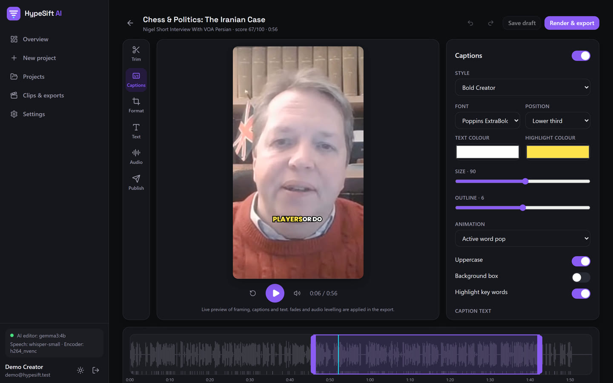

# HypeSift AI

[](https://github.com/sidxcodes/HypeSift-AI/actions/workflows/ci.yml)   

**Find the Hype. Create the Highlight.**

HypeSift AI turns long videos into ready-to-post shorts. Paste a video link or upload a file, press
**AI Generate**, and you get several finished clips — trimmed on complete thoughts, reframed to 9:16
around the speaker, captioned word-by-word, normalised for social audio — plus titles, descriptions and
hashtags for YouTube Shorts, Instagram Reels, TikTok, LinkedIn, Facebook and X. Every clip comes with an
**explainable 0–100 score** showing *why* it was picked, and everything can be edited in a browser editor
before you download.

It runs entirely on free, local tools: FFmpeg, faster-whisper, OpenCV and (optionally) a local LLM through
Ollama. No paid APIs, no keys.


| Browser editor | Publishing package |
|---|---|
|  |  |

*Screenshots are real output: a public-domain VOA interview from Wikimedia Commons, imported by direct link.*

| | |
|---|---|
| Frontend | Next.js 15 · React 19 · TypeScript · Tailwind CSS 4 · Motion |
| API | FastAPI · SQLAlchemy 2 · Pydantic 2 (SQLite by default, Postgres-ready) |
| Jobs | Persistent DB-backed queue; embedded or separate worker process |
| Video | FFmpeg (NVENC when available, libx264 fallback) · libass caption burn-in |
| Speech | faster-whisper with word timestamps (CUDA → CPU fallback) |
| Vision | OpenCV face + motion tracking, histogram scene-cut detection |
| AI editor | Ollama + `gemma3:4b` (optional) for semantic re-ranking and copywriting |

## What works today

- **Input:** resumable chunked uploads (MP4/MOV/MKV/WEBM/M4V/AVI, validated with ffprobe) and direct
  video-file links. YouTube/Vimeo/TikTok links show their public oEmbed details; their terms don't allow
  third-party downloading, so HypeSift asks for the creator's own file instead of bypassing that.
- **AI Generate (one click):** import → transcribe → audio/visual analysis → candidate windows →
  ranking → per-clip reframing → render → publishing copy. Real stage-by-stage progress from the worker,
  with cancel.
- **Highlight detection:** sentence-aligned windows scored on 7 dimensions — hook strength, context clarity,
  pacing, novelty, emotional intensity, visual interest, audience relevance — from transcript structure,
  loudness, spectral flux, noise-like bursts (laughter/applause proxy), motion and scene cuts. Genre
  profiles (podcast, gaming, education, tutorial, entertainment, vlog, review) and moods reweight them.
  Near-duplicates are suppressed. The local LLM, if running, re-reads the shortlist and contributes 30%.
- **Captions:** six presets (Clean Minimal, Bold Creator, Gaming Energy, Podcast, Cinematic, Karaoke
  Highlight), active-word highlight/pop/karaoke fill, keyword emphasis, editable text, SRT export.
  The browser preview uses the same fonts and metrics as the burned-in export.
- **Reframing:** 9:16, 1:1, 4:5, 16:9; smart (face/motion "camera operator" path), manual with drag,
  centre, fit-with-blurred-fill, and a stacked two-speaker layout when two faces are detected.
- **Editor:** canvas preview, loudness timeline with word-snapping trim handles, caption/format/text/audio
  panels, title overlay, watermark, fades, gain and loudness normalisation, silence removal, undo/redo,
  re-render and download.
- **Publishing packages:** per-platform titles, descriptions, search terms, hashtags, CTAs and pinned-comment
  ideas in six tones; editable, one-click copy. Every package is labelled with the engine that wrote it.
- **Creator assistant:** "Find the funniest 30-second moment", "Make three emotional clips near the end",
  "Use bold yellow captions", "Write an Instagram caption", "Remove silences" → real jobs. Unsupported
  requests (music, dubbing, auto-posting…) get an honest "not yet" instead of a fake success.
- **Feedback loop:** 👍/👎 on clips nudges your account's dimension weights in future runs.
- **Accounts & safety:** scrypt passwords, HttpOnly session cookies, per-user isolation, rate-limited auth,
  HMAC-signed expiring media links, SSRF guard on URL imports, upload size/duration/clip quotas, temp-file
  cleanup.

## Run it locally

Prerequisites (all free): **Python 3.12+**, **Node 20+**, **FFmpeg** on PATH (`winget install Gyan.FFmpeg`,
`brew install ffmpeg`, or `apt install ffmpeg`). Optional: **Ollama** with `ollama pull gemma3:4b`, and an
NVIDIA GPU for faster transcription and encoding.

```bash
# 1. API + worker (http://127.0.0.1:8000)
cd backend
python -m venv .venv
.venv/Scripts/activate            # Windows  (macOS/Linux: source .venv/bin/activate)
pip install -r requirements-dev.txt
cp .env.example .env              # optional
uvicorn app.main:app --port 8000

# 2. Web app (http://localhost:3000)
cd frontend
npm install
cp .env.example .env.local
npm run dev
```

Create an account at `/signup`, then **New project → AI Generate**.

GPU transcription (optional): `pip install nvidia-cublas-cu12 "nvidia-cudnn-cu12>=9,<10"` inside the venv.
HypeSift loads them automatically and falls back to CPU if anything is missing.

**Docker:** `docker compose up --build` (add `--profile llm` for the Ollama container).

**Sample video:** `powershell -File scripts/make_sample_video.ps1` builds a 3-minute synthetic podcast with
real speech (Windows TTS) for trying the pipeline. `backend/scripts/upload_and_generate.py` drives the
whole flow from the command line, and `backend/scripts/smoke_pipeline.py` runs the pipeline without the API.

## Tests and checks

```bash
cd backend && pytest -q && ruff check app tests scripts      # 37 tests incl. a full HTTP end-to-end run
cd frontend && npx tsc --noEmit && npm run lint && npm run build
```

The end-to-end test signs up, uploads in chunks (including a wrong-offset retry), runs AI Generate on an
FFmpeg-generated video, checks that the export is a real 720×1280 MP4 with audio, edits and re-renders a
clip, drives the assistant, and confirms another account can't read the project.

## Measured on the development machine

i5-13450HX, RTX 3050 6 GB laptop, Windows 11:

| Input | Result |
|---|---|
| 2:53 synthetic podcast, upload → 4 finished clips | 90 s total (whisper `small` on CUDA, gemma3:4b ranking + copy, NVENC renders) |
| 1:55 public-domain interview via direct link | 67 s total, 2 clips, face-tracked crops |
| Transcription only, 1:55 of speech | 4.5 s (`small`, CUDA) · ~7 s (`base`, CPU) |
| Re-render one 27 s clip from the editor | ~10 s |

## Honest limitations

- Scores are heuristic estimates of how well a moment stands alone as a short. They are **not** view,
  virality or revenue predictions, and the weights are hand-tuned starting points.
- Quality depends on the speech model: `base` mishears names; `small` (default) is much better; `medium`
  is better still but slower.
- Laughter/applause detection is an acoustic proxy (loud, noise-like sound), not a trained classifier.
- Face tracking uses OpenCV Haar cascades: fast and dependency-free, but weaker on profiles, low light and
  small faces.
- Colour emoji can't be burned into video by libass, so emoji stay in the publishing text.
- No direct posting to social platforms yet; download the MP4 and paste the generated copy.
- One worker processes one job at a time by default; long videos queue. See
  [docs/ARCHITECTURE.md](docs/ARCHITECTURE.md) for scaling notes.

More: [architecture & API](docs/ARCHITECTURE.md) · [research notes & roadmap](docs/RESEARCH.md)

Only process videos you own or have permission to use.

MIT licensed — see [LICENSE](LICENSE).
