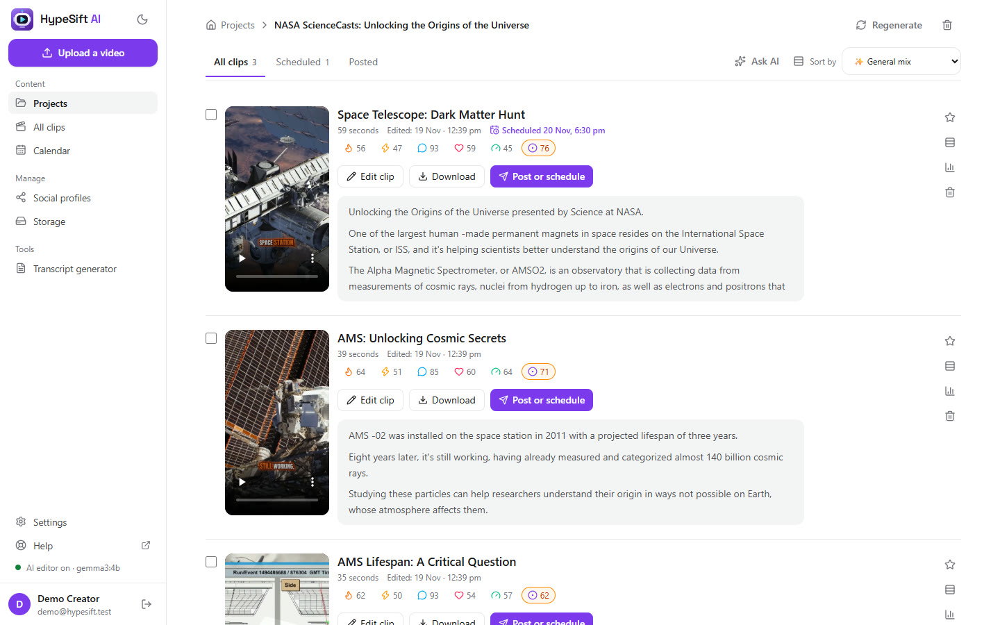
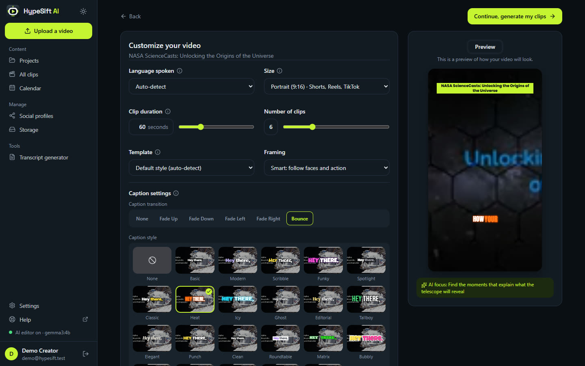
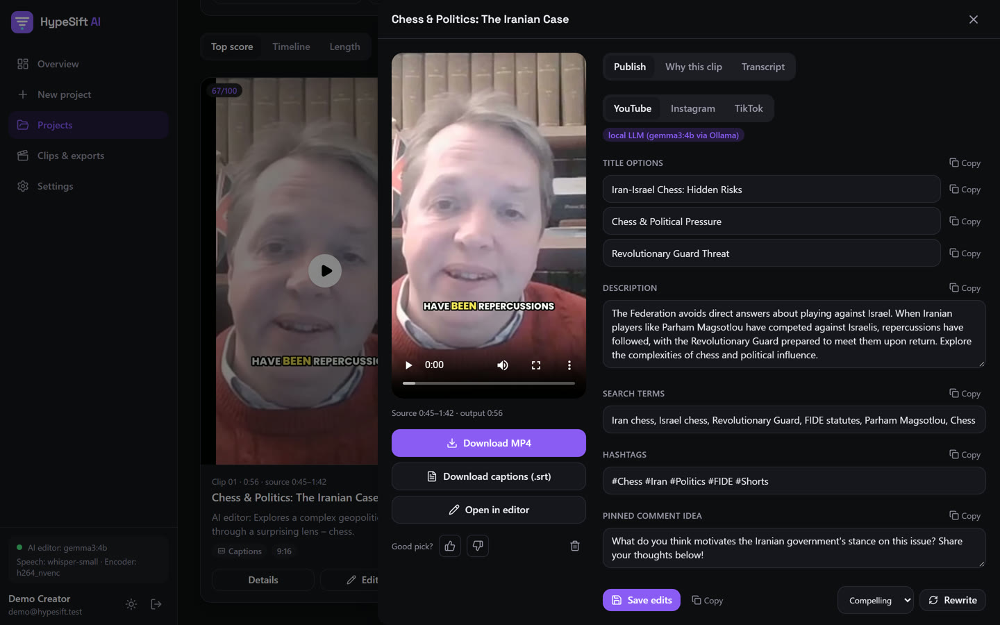

# HypeSift AI

[](https://github.com/sidxcodes/HypeSift-AI/actions/workflows/ci.yml)   

**Find the Hype. Create the Highlight.**

HypeSift AI turns long videos into ready-to-post shorts. Paste a **YouTube link** or upload a file, tell the
AI what to look for in your own words, pick a caption look in a live 9:16 preview, and you get several
finished clips — trimmed on complete thoughts, reframed to 9:16
around the speaker, captioned word-by-word, normalised for social audio — plus titles, descriptions and
hashtags for YouTube Shorts, Instagram Reels, TikTok, LinkedIn, Facebook and X. Every clip comes with an
**explainable 0–100 score** showing *why* it was picked, and everything can be edited in a browser editor
before you download.

It runs entirely on free, local tools: FFmpeg, faster-whisper, OpenCV and (optionally) a local LLM through
Ollama. No paid APIs, no keys.



| Customize with a live preview | Post or schedule |
|---|---|
|  |  |

*Screenshots are real output from a public NASA Science video, imported by its YouTube link.*

| | |
|---|---|
| Frontend | Next.js 15 · React 19 · TypeScript · Tailwind CSS 4 · Motion |
| API | FastAPI · SQLAlchemy 2 · Pydantic 2 (SQLite by default, Postgres-ready) |
| Jobs | Persistent DB-backed queue; embedded or separate worker process |
| Video | FFmpeg (NVENC when available, libx264 fallback) · libass caption burn-in |
| Speech | faster-whisper with word timestamps (CUDA → CPU fallback) |
| Vision | OpenCV face + motion tracking, histogram scene-cut detection |
| AI editor | Ollama + `gemma3:4b` (optional) for semantic re-ranking and copywriting |

## What works today

- **Input:** paste a **YouTube link** (watch, `youtu.be`, Shorts, embeds, live replays) or one from TikTok,
  Instagram, X, Reddit, Vimeo, Twitch, Facebook, Dailymotion and the 1,800+ other sites supported by the
  free, open-source [yt-dlp](https://github.com/yt-dlp/yt-dlp); direct video-file links; or resumable
  chunked uploads (MP4/MOV/MKV/WEBM/M4V/AVI, validated with ffprobe). Links are checked in about 2 s
  (title, channel, length, size) and downloaded as 1080p H.264 + AAC, so they play in the editor without
  re-encoding. Playlists, channels and live streams are refused with a clear reason, and so are private,
  members-only and region-blocked videos. Age-restricted and "confirm you're not a bot" videos can use your own browser
  login if you opt in (`HYPESIFT_YTDLP_COOKIES_BROWSER=edge`). The desktop app keeps yt-dlp updated.
  Only import videos you own or have permission to use.
- **Import → Customize → Generate:** paste a link, optionally add **custom instructions** ("find the
  moments where she shares concrete pricing advice"), then customize: language, clip duration, number of
  clips, template, size, caption transition/style/effect, auto-highlighted keywords, auto-zoom, logo and
  background music, all in a live 9:16 preview that plays the actual video. Then: import → transcribe →
  analysis → ranking → reframing → render → publishing copy, with a step banner and cancel.
- **Custom instructions steer the AI:** topic words from your request raise the relevance score (with stem
  matching), the local LLM gets a wider shortlist and rates each moment's *fit* to your request, and the
  LLM's say in the final score rises from 40% to 50%.
- **Highlight detection:** sentence-aligned windows scored on 7 dimensions — hook strength, context clarity,
  pacing, novelty, emotional intensity, visual interest, audience relevance — from transcript structure,
  loudness, spectral flux, noise-like bursts (laughter/applause proxy), motion and scene cuts. Genre
  profiles (podcast, gaming, education, tutorial, entertainment, vlog, review) and moods reweight them.
  Near-duplicates are suppressed. The local LLM, if running, re-reads the shortlist and contributes 40%.
- **Captions:** 22 styles (Basic, Modern, Scribble, Funky, Spotlight, Classic, Heat, Icy, Ghost, Editorial,
  Tallboy, Elegant, Punch, Clean, Roundtable, Matrix, Bubbly, Mint, Karaoke, Arcade, Podcast, Cinematic)
  in 13 free fonts; transitions (Fade Up/Down/Left/Right, Bounce); effects (Glow, 3D shadow, Typewriter,
  Tilt); active-word highlight/pop/karaoke fill, auto-highlighted keywords, editable text, SRT export.
  The browser preview uses the same fonts and metrics as the burned-in export.
- **Retention tools for Shorts:** punch-in zooms at the start and on key phrases, a hook title for the first
  3 s, an optional progress bar, silence removal, your logo in a corner, and background music that ducks
  automatically under speech.
- **Sort by goal + Shorts checklist:** sort clips for *More views*, *Build trust*, *Teach something* or
  *Entertain*. Each clip shows a viral-potential estimate with a checklist: opening line, hook text,
  15–45 s length, 9:16, captions, a face on screen, a clean loop, and zoom/progress bar, each with a fix.
- **Reframing:** 9:16, 1:1, 4:5, 16:9; smart (face/motion "camera operator" path), manual with drag,
  centre, fit-with-blurred-fill, a stacked two-speaker layout when two faces are detected, and a
  **gameplay / stream layout**: HypeSift finds a streamer's webcam overlay (a small, live face that stays
  put across the whole video, snapped to the overlay's border), puts it on top and the game or shared screen
  below, with captions on the join. Picked automatically, or forced from Framing.
- **Editor:** canvas preview, loudness timeline with word-snapping trim handles, caption/format/text/audio
  panels, title overlay, watermark, fades, gain and loudness normalisation, silence removal, undo/redo,
  re-render and download.
- **Publishing packages:** per-platform titles, descriptions, search terms, hashtags, CTAs and pinned-comment
  ideas in six tones; YouTube titles put searchable words first and always carry #Shorts. Editable,
  one-click copy, and labelled with the engine that wrote them.
- **Post or schedule:** a drawer with each platform's title, caption and options (YouTube category and
  visibility, TikTok who-can-view and comment/duet/stitch). *Post now* downloads the clip, copies the text
  and opens that platform's upload page. *Schedule* puts it on the **Calendar** with suggested posting
  times and reminds you (in the app and as a desktop notification) when it's due. All clips / Scheduled /
  Posted tabs track it.
- **Also in the sidebar:** Social profiles (your handles and time zone), Storage (disk use per project),
  and a **Transcript generator** (any link or file → searchable, timestamped transcript, TXT/SRT).
- **Creator assistant:** "Find the funniest 30-second moment", "Make three emotional clips near the end",
  "Use bold yellow captions", "Write an Instagram caption", "Remove silences" → real jobs. Unsupported
  requests (music, dubbing, auto-posting…) get an honest "not yet" instead of a fake success.
- **Feedback loop:** 👍/👎 on clips nudges your account's dimension weights in future runs.
- **Accounts & safety:** scrypt passwords, HttpOnly session cookies, per-user isolation, rate-limited auth,
  HMAC-signed expiring media links, SSRF guard on URL imports, upload size/duration/clip quotas, temp-file
  cleanup.

## Use it as a desktop app (Windows)

```powershell
powershell -ExecutionPolicy Bypass -File desktop\install.ps1
```

This creates a **HypeSift AI** shortcut on the Desktop and in the Start menu. Clicking it opens HypeSift in its
own app window, with no console windows. Behind the scenes it starts Ollama (if installed), the API and a
production build of the web app. Closing the last HypeSift window stops the servers again.

- Typical start time is about 6 s. After a code change, the first launch rebuilds the web app (about 30 s).
- The app runs on `127.0.0.1` only (ports 8765 and 3765), and your login is remembered in the app window.
- Logs are written to `%LOCALAPPDATA%\HypeSift\logs`.

## Run it locally (development)

Prerequisites (all free): **Python 3.12+**, **Node 20+**, **FFmpeg** on PATH (`winget install Gyan.FFmpeg`,
`brew install ffmpeg`, or `apt install ffmpeg`). Optional: **Ollama** with `ollama pull gemma3:4b`, and an
NVIDIA GPU for faster transcription and encoding.

```bash
# 1. API + worker (http://127.0.0.1:8000)
cd backend
python -m venv .venv
.venv/Scripts/activate            # Windows  (macOS/Linux: source .venv/bin/activate)
pip install -r requirements-dev.txt
cp .env.example .env              # optional
uvicorn app.main:app --port 8000

# 2. Web app (http://localhost:3000)
cd frontend
npm install
cp .env.example .env.local
npm run dev
```

Create an account at `/signup`, then **New project → AI Generate**.

GPU transcription (optional): `pip install nvidia-cublas-cu12 "nvidia-cudnn-cu12>=9,<10"` inside the venv.
HypeSift loads them automatically and falls back to CPU if anything is missing.

**Docker:** `docker compose up --build` (add `--profile llm` for the Ollama container).

**Sample video:** `powershell -File scripts/make_sample_video.ps1` builds a 3-minute synthetic podcast with
real speech (Windows TTS) for trying the pipeline. `backend/scripts/upload_and_generate.py` drives the
whole flow from the command line, and `backend/scripts/smoke_pipeline.py` runs the pipeline without the API.

## Tests and checks

```bash
cd backend && pytest -q && ruff check app tests scripts      # 108 tests incl. full HTTP end-to-end runs
cd frontend && npx tsc --noEmit && npm run lint && npm run build
```

The end-to-end test signs up, uploads in chunks (including a wrong-offset retry), runs AI Generate on an
FFmpeg-generated video, checks that the export is a real 720×1280 MP4 with audio, edits and re-renders a
clip, drives the assistant, and confirms another account can't read the project.

## Measured on the development machine

i5-13450HX, RTX 3050 6 GB laptop, Windows 11:

| Input | Result |
|---|---|
| 2:53 synthetic podcast, upload → 4 finished clips | 90 s total (whisper `small` on CUDA, gemma3:4b ranking + copy, NVENC renders) |
| 1:55 public-domain interview via direct link | 67 s total, 2 clips, face-tracked crops |
| 3:11 YouTube link + custom instructions → 3 clips (Heat style, glow, zoom, progress bar) | 138 s total |
| Transcription only, 1:55 of speech | 4.5 s (`small`, CUDA) · ~7 s (`base`, CPU) |
| Re-render one 27 s clip from the editor | ~10 s |

## Honest limitations

- Scores are heuristic estimates of how well a moment stands alone as a short. They are **not** view,
  virality or revenue predictions, and the weights are hand-tuned starting points.
- Quality depends on the speech model: `base` mishears names; `small` (default) is much better; `medium`
  is better still but slower.
- Laughter/applause detection is an acoustic proxy (loud, noise-like sound), not a trained classifier.
- Face tracking uses OpenCV Haar cascades: fast and dependency-free, but weaker on profiles, low light and
  small faces.
- Colour emoji can't be burned into video by libass, so emoji stay in the publishing text.
- No automatic posting: platforms only allow that through developer apps they approve. *Post now* hands you
  the file and the text on the platform's own upload page; scheduled posts are reminders, not auto-posts.
- The viral-potential number and checklist are estimates from the clip itself, not view predictions.
- One worker processes one job at a time by default; long videos queue. See
  [docs/ARCHITECTURE.md](docs/ARCHITECTURE.md) for scaling notes.

More: [architecture & API](docs/ARCHITECTURE.md) · [research notes & roadmap](docs/RESEARCH.md)

Only process videos you own or have permission to use.

MIT licensed — see [LICENSE](LICENSE).
